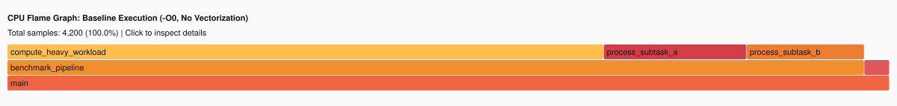
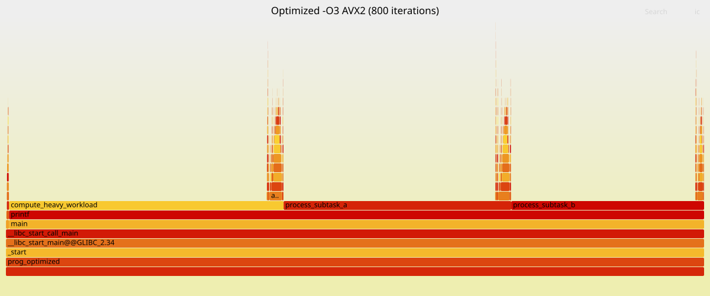

# Measured results (auto-generated)

## 1. Baseline vs optimized (time, perf stat, energy)

| Metric | Baseline | Optimized | Delta |
|---|---|---|---|
| Wall time (s) | 51.950 | 6.260 | -87.9% |
| User time (s) | 35.860 | 4.120 | -88.5% |
| Max RSS (MB) | 49.9 | 49.9 | -0.0% |
| Cycles (G) | n/a | n/a | n/a |
| Instructions (G) | 44.39 | 4.89 | -89.0% |
| IPC | n/a | n/a | n/a |
| Branch miss (%) | 0.21 | 0.19 | -9.1% |
| L1d miss (%) | n/a | n/a | n/a |
| LLC miss (%) | n/a | n/a | n/a |
| System energy (J) | 181.980 | 23.120 | -87.3% |
| Program-only energy (J) | 12.679 | 2.985 | -76.5% |
| Avg power (W) | 3.99 | 4.27 | +6.8% |

## 2. Energy
```
================================================================================
                    ENERGY CONSUMPTION MEASUREMENT REPORT
================================================================================
Baseline Idle Power (measured with `perf stat -a sleep`):
  Package (CPU Core + Uncore):              3.45 W
  DRAM (Memory Subsystem):                  0.26 W
  Total Idle Power:                         3.72 W

1. BASELINE PROGRAM (-O0)
--------------------------------------------------------------------------------
Execution Wall Time (T_elapsed):             45.560 s
CPU Package Energy (E_pkg):                  168.780 J
RAM Energy (E_dram):                         13.200 J
Total System Energy during run (E_system):   181.980 J
Average Total Power during run (P_avg):      3.99 W
Program-only Dynamic Package Energy:         11.416 J
Program-only Dynamic RAM Energy:             1.263 J
Total Program-only Dynamic Energy (E_prog):  12.679 J

2. OPTIMIZED PROGRAM (-O3 + AVX2 + FMA + FastMath)
--------------------------------------------------------------------------------
Execution Wall Time (T_elapsed):             5.418 s
CPU Package Energy (E_pkg):                  20.950 J
RAM Energy (E_dram):                         2.170 J
Total System Energy during run (E_system):   23.120 J
Average Total Power during run (P_avg):      4.27 W
Program-only Dynamic Package Energy:         2.235 J
Program-only Dynamic RAM Energy:             0.750 J
Total Program-only Dynamic Energy (E_prog):  2.985 J

3. COMPARATIVE ANALYSIS & CONCLUSIONS
--------------------------------------------------------------------------------
Execution Time Speedup:                      8.41x faster
System Energy Reduction:                     87.3% reduction
Program-only Dynamic Energy Reduction:       76.5% reduction
Average Power Change:                        +6.8% (race-to-sleep: power may rise, energy = P x t falls)
================================================================================
```

## 3. Assembly instruction mix
```
=== asm/baseline_O0.s ===
total instructions:        302
scalar FP (*ss):           58
packed FP (*ps, 4/8 lanes): 0
ymm (256-bit) operands:    0
xmm (128-bit) operands:    80
--- top FP/vector mnemonics ---
     36 movss
     12 addss
     10 mulss
      6 cvtsi2ssq
      1 cvtss2sd

=== asm/optimized_O3_avx2.s ===
total instructions:        555
scalar FP (*ss):           93
packed FP (*ps, 4/8 lanes): 52
ymm (256-bit) operands:    0
xmm (128-bit) operands:    249
--- top FP/vector mnemonics ---
     47 movss
     25 mulss
     21 addss
     17 addps
     15 shufps
     14 mulps
     11 movaps
     11 cvtsi2ssq
     10 movups
      3 cvtdq2ps
      1 cvtss2sd
```

## 4. Flag ablation (which flag gives what)
```
variant                  time(s)    checksum
O0                       11.634     Checksum: 46513.136719
O3_sse2                  2.534      Checksum: 46513.136719
O3_sse2_fastmath         1.549      Checksum: 46472.707031
O3_avx2_fma              2.070      Checksum: 46513.136719
O3_avx2_fma_fastmath     1.470      Checksum: 46472.707031
```

## 5. /usr/bin/time -v (baseline)
```
	Command being timed: "./bin/prog_baseline"
	User time (seconds): 35.86
	System time (seconds): 0.58
	Percent of CPU this job got: 70%
	Elapsed (wall clock) time (h:mm:ss or m:ss): 0:51.95
	Average shared text size (kbytes): 0
	Average unshared data size (kbytes): 0
	Average stack size (kbytes): 0
	Average total size (kbytes): 0
	Maximum resident set size (kbytes): 51132
	Average resident set size (kbytes): 0
	Major (requiring I/O) page faults: 0
	Minor (reclaiming a frame) page faults: 12383
	Voluntary context switches: 3
	Involuntary context switches: 17858
	Swaps: 0
	File system inputs: 0
	File system outputs: 0
	Socket messages sent: 0
	Socket messages received: 0
	Signals delivered: 0
	Page size (bytes): 4096
	Exit status: 0
```

## 6. /usr/bin/time -v (optimized)
```
	Command being timed: "./bin/prog_optimized"
	User time (seconds): 4.12
	System time (seconds): 0.24
	Percent of CPU this job got: 69%
	Elapsed (wall clock) time (h:mm:ss or m:ss): 0:06.26
	Average shared text size (kbytes): 0
	Average unshared data size (kbytes): 0
	Average stack size (kbytes): 0
	Average total size (kbytes): 0
	Maximum resident set size (kbytes): 51108
	Average resident set size (kbytes): 0
	Major (requiring I/O) page faults: 0
	Minor (reclaiming a frame) page faults: 12380
	Voluntary context switches: 1
	Involuntary context switches: 2061
	Swaps: 0
	File system inputs: 0
	File system outputs: 0
	Socket messages sent: 0
	Socket messages received: 0
	Signals delivered: 0
	Page size (bytes): 4096
	Exit status: 0
```

## 7. perf stat -d (baseline)
```
# started on Sat Oct 24 22:51:32 2026


 Performance counter stats for './bin/prog_baseline' (3 runs):

            18,885      context-switches                 #    492.4 cs/sec  cs_per_second       ( +-  3.92% )
               108      cpu-migrations                   #      2.8 migrations/sec  migrations_per_second  ( +- 29.44% )
            12,366      page-faults                      #    322.5 faults/sec  page_faults_per_second  ( +-  0.03% )
         38,350.01 msec task-clock                       #      0.7 CPUs  CPUs_utilized         ( +-  0.48% )
       134,397,280      LLC-loads                        #      4.6 %  llc_miss_rate            ( +-  2.09% )  (42.92%)
         5,480,230      branch-misses                    #      0.2 %  branch_miss_rate         ( +-  4.87% )  (28.54%)
     2,630,857,016      branches                         #     68.6 M/sec  branch_frequency     ( +-  0.09% )  (28.53%)
    29,617,832,833      cpu-cycles                       #      0.8 GHz  cycles_frequency       ( +-  0.52% )  (42.79%)
    44,394,990,373      instructions                     #      1.5 instructions  insn_per_cycle  ( +-  0.02% )  (42.83%)

      52.989729915 +- 2.764375428 seconds time elapsed  ( +-  5.22% )
```

## 8. perf stat -d (optimized)
```
# started on Sat Oct 24 22:54:11 2026


 Performance counter stats for './bin/prog_optimized' (3 runs):

             2,175      context-switches                 #    460.5 cs/sec  cs_per_second       ( +-  3.81% )
                32      cpu-migrations                   #      6.8 migrations/sec  migrations_per_second  ( +- 14.69% )
            12,362      page-faults                      #   2617.6 faults/sec  page_faults_per_second  ( +-  0.00% )
          4,722.66 msec task-clock                       #      0.8 CPUs  CPUs_utilized         ( +-  0.20% )
       104,517,047      LLC-loads                        #      8.9 %  llc_miss_rate            ( +-  0.26% )  (42.70%)
           753,586      branch-misses                    #      0.2 %  branch_miss_rate         ( +-  2.44% )  (28.59%)
       397,965,495      branches                         #     84.3 M/sec  branch_frequency     ( +-  0.10% )  (28.69%)
     3,626,602,840      cpu-cycles                       #      0.8 GHz  cycles_frequency       ( +-  0.26% )  (42.95%)
     4,887,347,212      instructions                     #      1.3 instructions  insn_per_cycle  ( +-  0.04% )  (42.92%)

       5.930461406 +- 0.212553195 seconds time elapsed  ( +-  3.58% )
```

## 9. perf report (baseline, top 40 lines)
```
# To display the perf.data header info, please use --header/--header-only options.
#
#
# Total Lost Samples: 0
#
# Samples: 40K of event 'cpu/cycles/P'
# Event count (approx.): 30087964415
#
# Overhead       Samples  Command        Shared Object         Symbol                                                  
# ........  ............  .............  ....................  ........................................................
#
    47.46%         19081  prog_baseline  prog_baseline         [.] compute_heavy_workload
            |          
             --47.37%--compute_heavy_workload
                       benchmark_pipeline
                       main
                       __libc_start_call_main
                       __libc_start_main@@GLIBC_2.34
                       _start

    28.33%         11391  prog_baseline  prog_baseline         [.] process_subtask_a
            |          
             --28.26%--process_subtask_a
                       benchmark_pipeline
                       main
                       __libc_start_call_main
                       __libc_start_main@@GLIBC_2.34
                       _start

    19.29%          7755  prog_baseline  prog_baseline         [.] process_subtask_b
            |          
             --19.25%--process_subtask_b
                       benchmark_pipeline
                       main
                       __libc_start_call_main
                       __libc_start_main@@GLIBC_2.34
                       _start

     0.36%           146  prog_baseline  prog_baseline         [.] init_dataset
     0.12%            48  prog_baseline  [kernel.kallsyms]     [k] update_curr
```

## 9. perf report (optimized, top 40 lines)
```
# To display the perf.data header info, please use --header/--header-only options.
#
#
# Total Lost Samples: 0
#
# Samples: 4K of event 'cpu/cycles/P'
# Event count (approx.): 3626770222
#
# Overhead       Samples  Command         Shared Object      Symbol                                       
# ........  ............  ..............  .................  .............................................
#
    35.66%          1735  prog_optimized  prog_optimized     [.] compute_heavy_workload
            |          
             --35.47%--compute_heavy_workload
                       printf (inlined)
                       main
                       __libc_start_call_main
                       __libc_start_main@@GLIBC_2.34
                       _start

    28.97%          1405  prog_optimized  prog_optimized     [.] process_subtask_a
            |          
             --28.74%--process_subtask_a
                       printf (inlined)
                       main
                       __libc_start_call_main
                       __libc_start_main@@GLIBC_2.34
                       _start

    24.85%          1208  prog_optimized  prog_optimized     [.] process_subtask_b
            |          
             --24.77%--process_subtask_b
                       printf (inlined)
                       main
                       __libc_start_call_main
                       __libc_start_main@@GLIBC_2.34
                       _start

     0.59%            29  prog_optimized  prog_optimized     [.] init_dataset
     0.39%            19  prog_optimized  [kernel.kallsyms]  [k] kernel_init_pages
```

## 10. FlameGraphs




